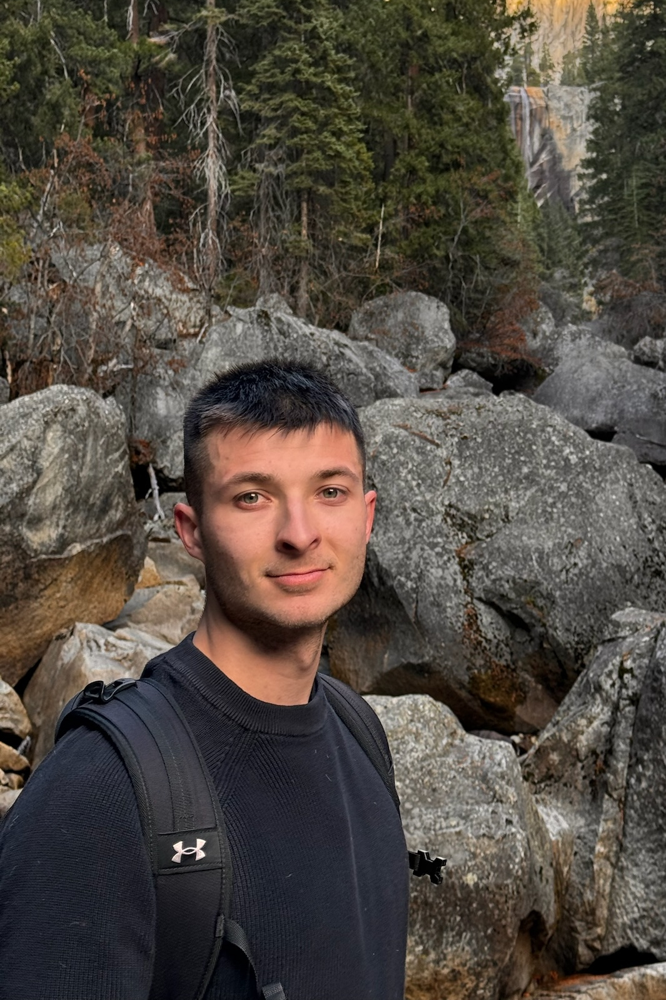

# Konrad Szafer

konrad [dot] szafer [at] inf [dot] ethz [dot] ch

I'm a PhD student in Computer Science at ETH Zurich, co-supervised by [Ana Klimovic](https://anakli.inf.ethz.ch/) and [Thomas Hofmann](https://scholar.google.com/citations?user=T3hAyLkAAAAJ). My research focuses on adaptation, continual learning, reinforcement learning, and systems.

Before my PhD, I was a research assistant at ETH Zurich working in these same areas. Previously, I interned at Hugging Face on the Evaluation team and spent half a year at CMU's AutonLab working on time-series foundation models.

I graduated from Poznan University of Technology with a BSc in Automatic Control and Robotics and an MSc in Artificial Intelligence (Summa Cum Laude Medal), focusing both of my theses on representation learning for 2D and 3D vision.

[Email](mailto:konrad.szafer@inf.ethz.ch) · [X](https://x.com/KonradSzafer) · [LinkedIn](https://www.linkedin.com/in/konrad-szafer/) · [Google Scholar](https://scholar.google.com/citations?user=qm-fDwoAAAAJ&hl=en) · [GitHub](https://github.com/KonradSzafer) · [Hugging Face](https://huggingface.co/KonradSzafer)
