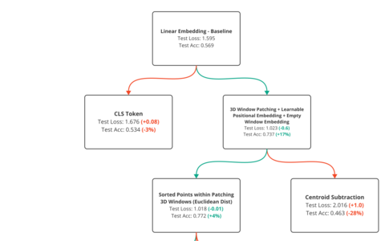

# Blog

## [Tech Tree - A Systematic Approach to ML Research (and Beyond)](https://huggingface.co/spaces/KonradSzafer/tech_tree_blog)

[read](https://huggingface.co/spaces/KonradSzafer/tech_tree_blog)

A graph of implemented ideas that documents research progress and builds better mental models of how components interact.
