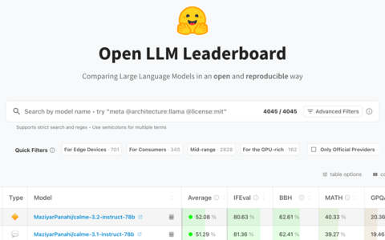
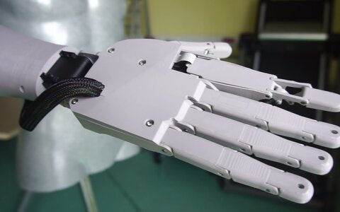

# Projects

## [Open LLM Leaderboard v2](https://huggingface.co/spaces/open-llm-leaderboard/open_llm_leaderboard)

*Hugging Face · 2024*

[page](https://huggingface.co/spaces/open-llm-leaderboard/open_llm_leaderboard) · [blog](https://huggingface.co/spaces/open-llm-leaderboard/blog)

An evaluation suite benchmarking thousands of open-source large language models. Co-authored the v2 release on the Hugging Face Evaluation team.

## [AlterARM](https://www.youtube.com/watch?v=l0TNA1DbGiM)

*High School · 2018-2021*

[video](https://www.youtube.com/watch?v=l0TNA1DbGiM) · [channel](https://www.youtube.com/@alterarm4606)

A lightweight bionic prosthetic arm with 13 axes of freedom, a multi-grip hand, and EMG-based muscle control, costing under $1,000. Three iterations built by a two-person team, with over $2,000 in R&D funding from six companies, including Prusa Research and Linak.
