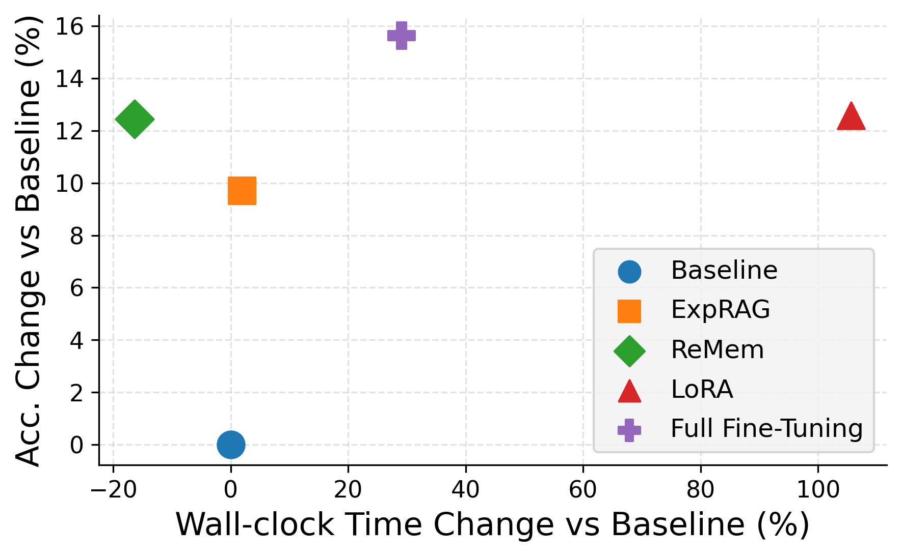
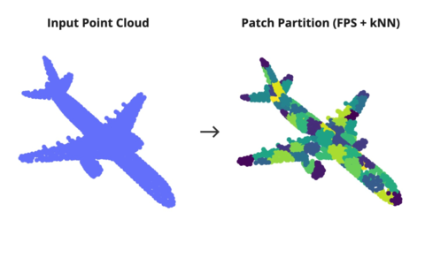
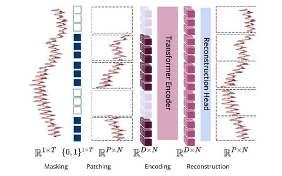
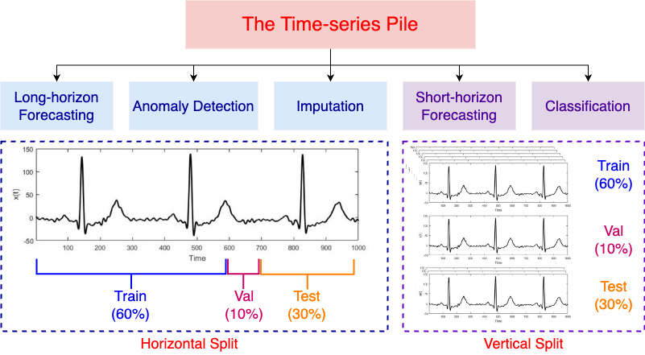

# Publications

## [Navigating the Cost-Performance Pareto Frontier of Test-Time LLM Agent Adaptation](https://openreview.net/pdf?id=tWAnCRYMcT)

**Konrad Szafer**, Xiaozhe Yao, Maximilian Böther, Gregor Bachmann, Tiago Pimentel, Ana Klimovic

*ICLR 2026 Lifelong Agent Workshop*

[paper](https://openreview.net/pdf?id=tWAnCRYMcT)

Compares accuracy and compute of in-context learning and RL fine-tuning for LLM agents with verifiable feedback after deployment. RL fine-tuning helps most when tasks benefit from better reasoning with the model's existing knowledge, but offers limited gains when they demand learning new facts.

## [Pointy - A Lightweight Transformer for Point Cloud Foundation Models](https://arxiv.org/abs/2603.10963)

**Konrad Szafer**, Marek Kraft, Dominik Belter

*ICLR 2025 Open Science for Foundation Models Workshop · ACIVS 2025*

[paper](https://arxiv.org/abs/2603.10963) · [code](https://github.com/KonradSzafer/Pointy) · [methodology blog](https://huggingface.co/spaces/KonradSzafer/tech_tree_blog)

A lightweight transformer trained on only 39k point clouds. It outperforms several larger foundation models trained on over 200k samples and approaches state-of-the-art models that have seen over a million point clouds together with other modalities.

## [MOMENT: A Family of Open Time-series Foundation Models](https://proceedings.mlr.press/v235/goswami24a.html)

Mononito Goswami, **Konrad Szafer**, Arjun Choudhry, Yifu Cai, Shuo Li, Artur Dubrawski

*ICML 2024*

[paper](https://proceedings.mlr.press/v235/goswami24a.html) · [model](https://huggingface.co/AutonLab/MOMENT-1-large) · [code](https://github.com/moment-timeseries-foundation-model/moment) · [research code](https://github.com/moment-timeseries-foundation-model/moment-research)

A family of open-source foundation models for general-purpose time-series modeling, pre-trained on the Time Series Pile and effective with minimal data and task-specific fine-tuning. Downloaded over 2M times, with 500+ GitHub stars.

## [Datasets for Time Series Foundation Models](https://icml.cc/virtual/2024/36389)

Arjun Choudhry, **Konrad Szafer**, Mononito Goswami, Yifu Cai, Artur Dubrawski

*ICML 2024 Workshop on Data-Centric Machine Learning Research*

[website](https://icml.cc/virtual/2024/36389) · [dataset](https://huggingface.co/datasets/AutonLab/Timeseries-PILE)

Introduces the Time Series Pile, a diverse collection of public datasets for pre-training and evaluating time-series foundation models across multiple tasks, spanning unsupervised to supervised settings.
